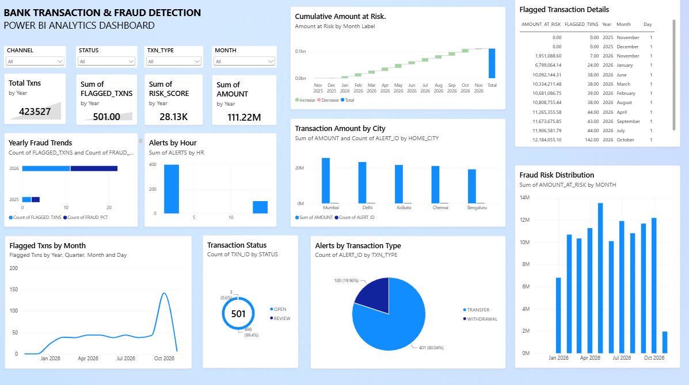

# Bank Transaction & Fraud Detection

Rule-based fraud detection system built with **Oracle SQL** and visualized in **Power BI**.

## Dashboard

## Project Overview
- Simulated bank data: 5,000 customers, 5,000 accounts, 500,000+ transactions
- Fraud rules implemented as SQL views and scored through a stored procedure
- Alerts stored in a `fraud_alerts` table, with a trigger for very large transactions
- Account freeze procedure for flagged accounts
- Report views exported to CSV and visualized in Power BI

## Fraud Rules
| Rule | Description |
|------|-------------|
| HIGH_AMOUNT | Amount greater than 5x the account average |
| VELOCITY | 5+ transactions within 10 minutes |
| ODD_HOUR | Transaction above 50k between 1 AM and 4 AM |
| LOCATION_JUMP | Different city within 1 hour |
| STRUCTURING | 5+ small deposits in a day, then a big withdrawal |

## Tech Stack
- Oracle 10g (SQL, PL/SQL, views, triggers, procedures)
- SQL*Plus
- Power BI, DAX

## Files
- `bank_fraud_queries.sql`: all SQL queries in run order
- `*.csv`: report views exported for Power BI
- `bank_fraud_dashboard.pbix`: Power BI dashboard
- `dashboard.png`: dashboard screenshot

## Note
The data is synthetic. Fraud patterns were injected on purpose to test the rules.
